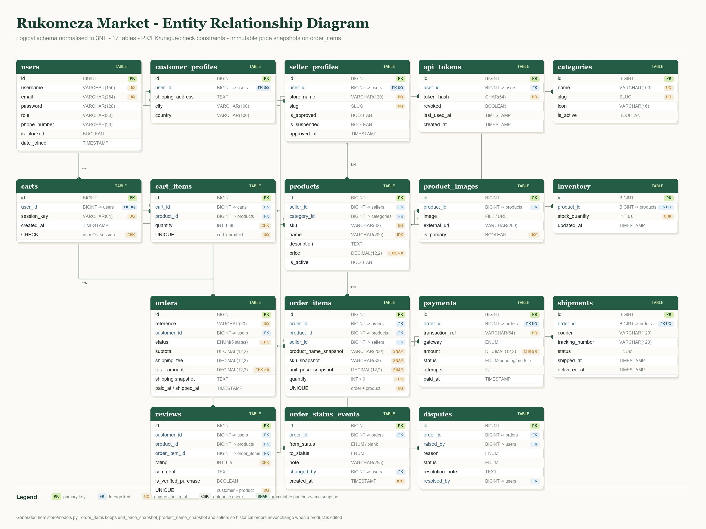
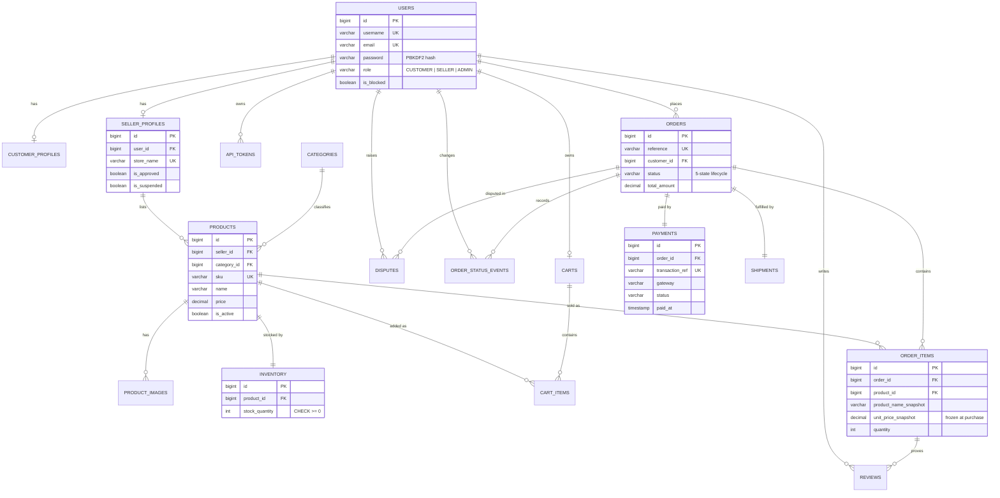

# Database design — Rukomeza Market



## 1. Entity relationship model

The marketplace has **17 tables**. `users` is the single authentication table; every
actor (customer, seller, administrator) is a user with a `role`. Role-specific
attributes live in one-to-one profile tables (`customer_profiles`,
`seller_profiles`), which avoids nullable role columns and keeps the schema in
3NF.



## 2. Normalisation argument (3NF)

| Normal form | How it is satisfied |
|---|---|
| **1NF** | Every column is atomic. Repeating groups are removed: product images are rows in `product_images`, cart lines in `cart_items`, order lines in `order_items`, and status changes in `order_status_events`. No comma-separated lists are stored. |
| **2NF** | Every table has a single-column surrogate primary key (`id`), so there are no partial dependencies on part of a composite key. Junction tables (`cart_items`, `order_items`) have their own key and a unique constraint on the pair. |
| **3NF** | Non-key attributes depend only on the key. Examples: the seller's store name is stored once in `seller_profiles`, not repeated on every product; a product's stock is in `inventory`, not in `products`; a payment's status is in `payments`, not duplicated on `orders`; a user's role is stored only in `users`, never copied to profiles. |
| **Controlled denormalisation** | `order_items` intentionally stores `product_name_snapshot`, `sku_snapshot`, `seller_name_snapshot` and `unit_price_snapshot`. These are **historical facts** about a purchase, not copies of mutable catalogue data. Without them, editing a product price would rewrite the meaning of past orders. |

Derived values such as a line total (`unit_price_snapshot × quantity`), a cart
subtotal, average rating and revenue are computed by queries rather than stored,
removing update anomalies.

## 3. Integrity constraints

Database-level constraints (enforced on SQLite and PostgreSQL):

| Table | Constraint | Purpose |
|---|---|---|
| `inventory` | `stock_quantity >= 0` | Physical stock can never be negative. |
| `inventory` | `product_id` unique | Exactly one stock row per product. |
| `products` | `price > 0` | Free products are rejected. |
| `cart_items` | `1 <= quantity <= 99` | Quantity limit per line. |
| `cart_items` | unique `(cart, product)` | One line per product per cart. |
| `orders` | `status IN (PENDING, PAID, SHIPPED, DELIVERED, CANCELLED)` | Controlled lifecycle at the storage layer. |
| `orders` | `total_amount, subtotal, shipping_fee >= 0` | No negative money. |
| `order_items` | `quantity > 0`, `unit_price_snapshot >= 0` | Valid historical lines. |
| `order_items` | unique `(order, product)` | A product appears once per order. |
| `reviews` | `rating BETWEEN 1 AND 5` | Rating scale. |
| `reviews` | unique `(customer, product)` | One review per buyer per product. |
| `product_images` | partial unique `(product) WHERE is_primary` | At most one primary image. |
| `disputes` | partial unique `(order) WHERE status IN ('OPEN','UNDER_REVIEW')` | One open dispute per order. |
| `payments` | `amount >= 0` | No negative payments. |

Lifecycle transitions are additionally enforced in
`Order.transition_to()` / `store.services.orders`:

```
PENDING -> PAID | CANCELLED
PAID    -> SHIPPED | CANCELLED
SHIPPED -> DELIVERED
DELIVERED, CANCELLED -> terminal
```

Cancelling restores stock exactly once; payment success is the only path to
`PAID`; shipping requires a paid order.

## 4. Key indexes

| Index | Columns | Supports |
|---|---|---|
| `product_cat_price_idx` | `category_id, price` | Category + price-range browse |
| `product_price_idx` | `price` | Price-range filter |
| `product_seller_active_idx` | `seller_id, is_active` | Seller catalogue |
| `product_name_idx` | `name` | Keyword/prefix search |
| `inventory_stock_idx` | `stock_quantity` | Low-stock report |
| `order_customer_status_idx` | `customer_id, status, created_at` | Customer order history |
| `order_status_created_idx` | `status, created_at` | Admin queues, revenue periods |
| `order_created_idx` | `created_at` | Period reporting |
| `order_item_order_idx` | `order_id` | Order detail |
| `order_item_seller_idx` | `seller_id` | Sales per seller |
| `review_product_idx` | `product_id, created_at` | Product reviews |

Keyword search uses `icontains` for portability. On PostgreSQL it can be
upgraded to `SearchVector` + a GIN index without changing the API.

## 5. Sample indexed queries

```sql
-- Category + price range (uses product_cat_price_idx)
SELECT p.* FROM store_product p
JOIN store_category c ON c.id = p.category_id
WHERE c.slug = 'electronics-tech' AND p.price BETWEEN 10000 AND 500000
  AND p.is_active = 1
ORDER BY p.price ASC;

-- Sales per seller from immutable snapshots (uses order_item_seller_idx)
SELECT s.store_name,
       SUM(oi.quantity) AS units,
       SUM(oi.quantity * oi.unit_price_snapshot) AS revenue
FROM store_orderitem oi
JOIN store_sellerprofile s ON s.id = oi.seller_id
JOIN store_order o ON o.id = oi.order_id
WHERE o.status IN ('PAID', 'SHIPPED', 'DELIVERED')
GROUP BY s.id, s.store_name
ORDER BY revenue DESC;

-- Revenue per month
SELECT strftime('%Y-%m', created_at) AS period,
       COUNT(*) AS orders, SUM(total_amount) AS revenue
FROM store_order
WHERE status IN ('PAID', 'SHIPPED', 'DELIVERED')
GROUP BY period ORDER BY period;

-- Best-selling products
SELECT oi.product_name_snapshot, SUM(oi.quantity) AS units,
       SUM(oi.quantity * oi.unit_price_snapshot) AS revenue
FROM store_orderitem oi
JOIN store_order o ON o.id = oi.order_id
WHERE o.status IN ('PAID', 'SHIPPED', 'DELIVERED')
GROUP BY oi.product_name_snapshot
ORDER BY units DESC LIMIT 10;

-- Low stock (uses inventory_stock_idx)
SELECT p.name, i.stock_quantity, p.low_stock_threshold
FROM store_inventory i
JOIN store_product p ON p.id = i.product_id
WHERE i.stock_quantity <= p.low_stock_threshold AND p.is_active = 1
ORDER BY i.stock_quantity ASC;
```

The ORM equivalents live in `store/services/catalogue.py` and
`store/services/reports.py`, and are exposed at `/api/v1/admin/reports/*`.
