# Rukomeza Market — Project Report

**A multi-vendor e-commerce marketplace with concurrency-safe inventory, price
snapshots and a documented mock payment flow.**

| | |
|---|---|
| **Project** | Smart E-Commerce Marketplace |
| **Student** | Joelle Rukomeza |
| **Stack** | Django 6.1 · PostgreSQL / SQLite · HTML/CSS/JS · Chart.js · Gunicorn · Render |
| **Repository** | <https://github.com/joelleruk-lab/smart-ecommerce-marketplace> |
| **Live URL** | `https://[your-service].onrender.com` — see §9 and `docs/DEPLOYMENT.md` |
| **Date** | November 2026 |

---

## Table of contents

1. [Executive summary](#1-executive-summary)
2. [Requirements and scope](#2-requirements-and-scope)
3. [System architecture](#3-system-architecture)
4. [Database design](#4-database-design)
5. [Back-end and API](#5-back-end-and-api)
6. [Payments](#6-payments)
7. [Concurrency and data integrity](#7-concurrency-and-data-integrity)
8. [Authentication, authorisation and security](#8-authentication-authorisation-and-security)
9. [Front-end and usability](#9-front-end-and-usability)
10. [Testing](#10-testing)
11. [Deployment](#11-deployment)
12. [Rubric mapping](#12-rubric-mapping)
13. [Limitations and future work](#13-limitations-and-future-work)
14. [Conclusion](#14-conclusion)
15. [Appendices](#15-appendices)

---

## 1. Executive summary

Rukomeza Market is a complete multi-vendor marketplace for Kampala. Customers
discover products from independent sellers, manage a single basket across stores,
pay through a test-mode gateway, and track every order from **Pending → Paid →
Shipped → Delivered / Cancelled**. Sellers manage only their own catalogue and
inventory. Administrators approve stores, moderate accounts, manage categories,
dispatch orders, resolve disputes and read revenue reports.

The two hardest requirements — **never overselling** and **never rewriting
history** — are handled at the database boundary:

* checkout validates and decrements stock inside one transaction using both a row
  lock and a conditional `UPDATE ... WHERE stock_quantity >= quantity`, so the
  database itself rejects the losing request under concurrency;
* every order line stores an immutable snapshot of the product name, SKU, seller
  name and unit price, so a later price change cannot alter a past order.

The system contains 17 normalised tables, 58 automated tests (including a
threaded overselling test), a JSON REST API with an OpenAPI 3.1 specification and
a Postman collection, a responsive storefront, seller studio and administrator
dashboard with Chart.js reports. It is configured for one-URL HTTPS deployment on
Render with PostgreSQL or Neon.

---

## 2. Requirements and scope

### 2.1 Actors

| Actor | Capabilities implemented |
|---|---|
| **Customer** | Register/login; browse, search and filter by keyword, category, price range and stock; product detail with images, description, price, stock, seller and reviews; persistent cart; checkout; mock payment (success/failure); order history; tracking; cancel before dispatch; open disputes; review only purchased products. |
| **Seller** | Apply for a store; after approval create, edit and deactivate only own listings; set stock; view own dashboard metrics; see orders containing own products and their line items. |
| **Administrator** | Activate/deactivate/block accounts; approve, suspend, reinstate or reject sellers; create/edit/delete categories; dispatch and deliver orders with courier/tracking; cancel/refund; resolve disputes; sales per seller, revenue per period, best sellers, low stock and category reports with charts. |

### 2.2 Functional scope

* Whole order lifecycle with an auditable status history.
* Atomic stock reservation and release on cancellation.
* Historical price snapshots.
* Test-mode payment flow with idempotent callbacks.
* Verified-purchase reviews.
* Server-side validation of quantities, prices, ownership and roles.
* REST API for every module and an HTML interface for every workflow.
* Seeded dataset large enough for marking and report screenshots.

### 2.3 Non-functional decisions

* Money is stored as `DECIMAL(12,2)` and serialised as decimal strings.
* All times are stored in UTC (`USE_TZ=True`) and displayed in Africa/Kampala.
* Passwords use Django's PBKDF2 hasher; API tokens are stored only as SHA-256
  hashes.
* The UI is responsive from 320 px to desktop and uses no JavaScript framework.

---

## 3. System architecture

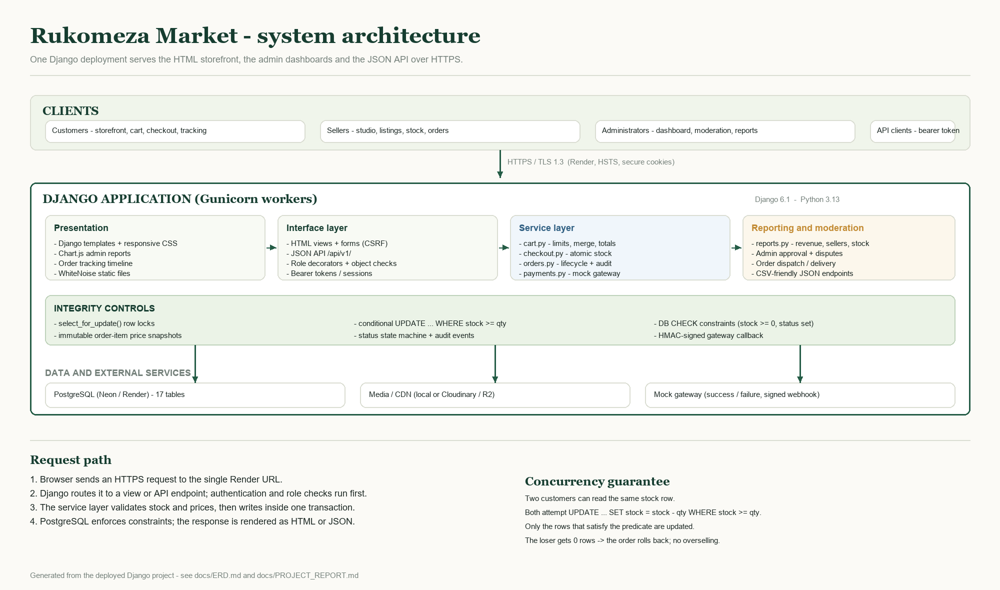

A single Django deployment serves the storefront, the seller studio, the
administrator dashboard and the JSON API. This keeps authentication, CSRF and
authorisation consistent and removes cross-origin complexity: the browser talks
to one HTTPS origin.

| Layer | Files | Responsibility |
|---|---|---|
| Presentation | `store/templates/store/*`, `web/css/*`, `web/js/*` | Server-rendered pages, responsive layout, Chart.js visualisations. |
| Interface | `store/views.py`, `store/api.py`, `store/forms.py`, `store/permissions.py` | Routing, form/JSON validation, role checks, serialisation. |
| Domain services | `store/services/cart.py`, `checkout.py`, `orders.py`, `payments.py`, `catalogue.py`, `reports.py` | Business rules, transactions, lifecycle, reporting. |
| Persistence | `store/models.py`, migrations | 17-table schema, constraints and indexes. |
| Infrastructure | `marketplace_project/settings.py`, `build.sh`, `render.yaml`, `Dockerfile` | Environment configuration, static files, deployment. |

The service layer is shared by the HTML views and the API, so both interfaces
enforce exactly the same price, stock and lifecycle rules.

---

## 4. Database design

### 4.1 Entity relationship diagram

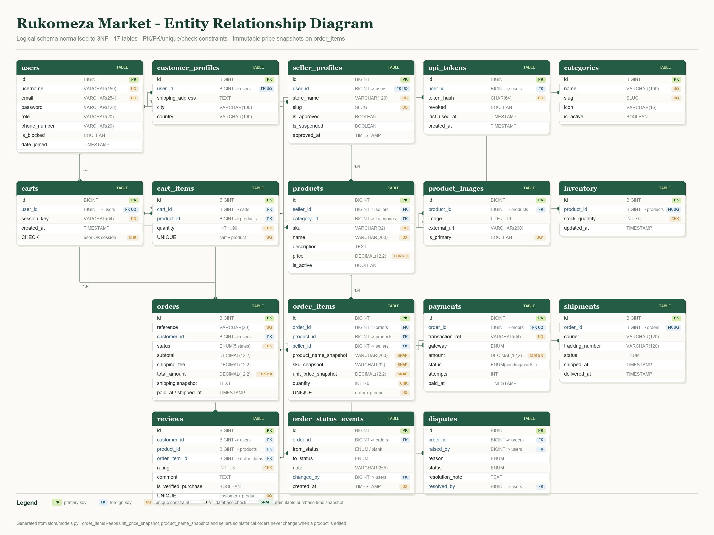

The full-size diagram is at `docs/erd.png`. A Mermaid version and the
normalisation argument are in `docs/ERD.md`.

The schema has 17 tables:

`users`, `customer_profiles`, `seller_profiles`, `api_tokens`, `categories`,
`products`, `product_images`, `inventory`, `carts`, `cart_items`, `orders`,
`order_items`, `order_status_events`, `payments`, `shipments`, `reviews`,
`disputes`.

### 4.2 Normalisation to 3NF

| Normal form | Evidence |
|---|---|
| **1NF** | All columns are atomic. Repeating groups become rows: `product_images`, `cart_items`, `order_items`, `order_status_events`. No comma-separated values. |
| **2NF** | Every table has a single surrogate primary key. Junction tables have their own `id` plus a unique constraint on the natural pair. No attribute depends on part of a key. |
| **3NF** | Non-key attributes depend only on the key. Seller data is stored once in `seller_profiles`; stock lives only in `inventory`; role lives only in `users`; payment state lives only in `payments`; a review stores its rating and comment, not a copy of the product. |
| **Intentional exception** | `order_items` keeps snapshot columns (`product_name_snapshot`, `sku_snapshot`, `seller_name_snapshot`, `unit_price_snapshot`). These are historical facts, not duplicated current data; they are required to fulfil the "price at purchase time" rule. |

Derived values (line total, subtotal, average rating, revenue) are computed in
queries, avoiding update anomalies.

### 4.3 Integrity constraints

| Constraint | Table | Why it matters |
|---|---|---|
| `stock_quantity >= 0` | `inventory` | Rejects negative stock even if application code is bypassed. |
| `price > 0` | `products` | Prevents invalid free/negative listings. |
| `1 <= quantity <= 99` | `cart_items` | Enforces the per-line quantity limit in the database. |
| `status IN (5 states)` | `orders` | Prevents unknown statuses at storage level. |
| `total_amount, subtotal, shipping_fee >= 0` | `orders` | Rejects negative money. |
| `quantity > 0`, `unit_price_snapshot >= 0` | `order_items` | Valid historical lines. |
| Unique `(order, product)` | `order_items` | No duplicate product lines. |
| `rating BETWEEN 1 AND 5` | `reviews` | Rating scale. |
| Unique `(customer, product)` | `reviews` | One review per buyer per product. |
| Partial unique primary image | `product_images` | At most one primary image per product. |
| Partial unique open dispute | `disputes` | One active dispute per order. |
| FK `PROTECT` on `orders.customer` | `orders` | Financial records survive account deletion attempts. |

The status lifecycle is enforced in `Order.transition_to()`:

```
PENDING  -> PAID | CANCELLED
PAID     -> SHIPPED | CANCELLED
SHIPPED  -> DELIVERED
DELIVERED / CANCELLED -> terminal
```

Every transition writes an `order_status_events` row with actor, note and
timestamp.

### 4.4 Price-snapshot design

`OrderItem` stores:

```python
product_name_snapshot = CharField(max_length=200)
sku_snapshot = CharField(max_length=32)
seller_name_snapshot = CharField(max_length=120)
unit_price_snapshot = DecimalField(max_digits=12, decimal_places=2)
```

When a product is edited, renamed or even deleted (`product` FK is `SET_NULL`),
the order still renders and reports correctly. The test
`test_order_line_price_snapshot_survives_product_price_change` proves that
changing the catalogue price leaves the order total and line snapshot unchanged.

### 4.5 Indexes and reports

Composite and single-column indexes support the required queries:

* `product_cat_price_idx (category_id, price)` — category + price-range browsing.
* `product_price_idx`, `product_name_idx`, `product_seller_active_idx`.
* `inventory_stock_idx` — low-stock report.
* `order_customer_status_idx`, `order_status_created_idx`, `order_created_idx`.
* `order_item_seller_idx` — sales per seller.
* `review_product_idx`.

Report queries are implemented in `store/services/reports.py` and documented in SQL
form in `docs/ERD.md`. They cover sales per seller, revenue per period, best
sellers, low stock and revenue by category, and exclude `PENDING`/`CANCELLED`
orders from revenue.

### 4.6 Seed data

`python manage.py seed_demo --reset` produces:

| Entity | Count |
|---|---|
| Categories | 7 |
| Sellers | 9 (8 approved, 1 pending approval demo) |
| Products | 30 |
| Customers | 20 |
| Orders | 40 |
| Order items | 81 |
| Reviews | 30 |
| Payments | 40 |
| Shipments | 18 |
| Status events | 100+ |
| Disputes | 3 |
| Carts | 5 |

The seed is deterministic (fixed random seed), creates local SVG product art so
the catalogue works offline, distributes orders over five months for chart
variety, and forces several low-stock products for the alerts report.

---

## 5. Back-end and API

### 5.1 Interfaces

The application exposes both a server-rendered interface and a JSON API. The
API is versioned at `/api/v1/` and documented in:

* `docs/openapi.yaml` — OpenAPI 3.1 (43 paths, schemas, security scheme).
* `docs/postman_collection.json` — importable collection with an auto-saving token.
* `/api/docs/` — human-readable endpoint reference served by the app.
* `/api/openapi.yaml` — the live specification.

Authentication uses opaque bearer tokens. Register/login return a token; the
plaintext is shown once and only its SHA-256 hash is stored. Tokens can be
revoked per device.

### 5.2 Modules

| Module | HTML | JSON API |
|---|---|---|
| Auth | `/register/`, `/login/`, `/logout/` | `POST /auth/register`, `/auth/login`, `/auth/logout`, `GET /auth/me` |
| Catalogue | `/`, `/shop/`, `/products/<id>/` | `GET /products` (q, category, price, seller, stock, sort, pagination), `/products/<id>`, `/products/<id>/reviews`, `/products/<id>/reviews/create`, `/categories` |
| Cart | `/cart/`, add/update/remove/clear | `GET /cart`, `POST /cart/items`, `PATCH/DELETE /cart/items/<id>`, `DELETE /cart/clear` |
| Checkout | `/checkout/` | `POST /orders` |
| Orders | `/account/`, `/orders/<id>/`, cancel, dispute | `GET /orders`, `GET /orders/<id>`, `/tracking`, `/cancel`, `/disputes` |
| Payments | `/payments/<order_id>/` | `GET /payments/<id>`, `POST /payments/<id>/pay`, `POST /payments/webhook/mock` |
| Seller | `/seller/`, edit, stock, toggle, orders | `GET /seller/summary`, `/seller/products`, `/seller/orders`; `POST /seller/products/create`; `PATCH/DELETE /seller/products/<id>`; `PATCH /seller/inventory/<id>` |
| Admin | `/dashboard/*` | Users, sellers + actions, categories CRUD, orders + status, disputes + resolve, 6 report endpoints |

### 5.3 Validation and error handling

* Registration: unique username/email, password validators, seller store-name
  uniqueness, role restricted to customer/seller.
* Products: minimum name/description lengths, positive price, active category,
  stock range 0–1,000,000.
* Cart: 1–99 per line, 50 distinct products, stock ceiling, product must be
  active and its seller approved.
* Checkout: non-empty delivery fields, 9+ digit phone, server-side total,
  optional `expected_total` mismatch detection (`409 price_changed`), stock
  re-check, quantity limit.
* Reviews: rating 1–5, comment 3–2,000 characters, verified purchase required,
  duplicate blocked.
* Admin actions: lifecycle transitions validated; seller approval checked before
  reinstatement; category deletion blocked while products exist.

Errors use consistent JSON:

```json
{"error": {"code": "insufficient_stock", "message": "Only 3 unit(s) ...", "details": {"product_id": 12, "available": 3}}}
```

An API middleware converts framework 403/404/405 HTML responses into JSON and
returns JSON 500s in production.

---

## 6. Payments

The project uses a **documented mock gateway** (permitted by the brief). The flow
is intentionally close to a real provider:

1. Checkout creates an order (`PENDING`) and a payment (`PENDING`) with a unique
   `PAY-...` reference and the server-calculated amount.
2. The payment page offers **simulate approval** and **simulate decline**.
3. Success sets payment `PAID`, `paid_at`, provider reference and moves the order
   to `PAID` with an audit event.
4. Failure records a `FAILED` attempt and reason, leaving the order `PENDING` for
   a retry.
5. A signed webhook endpoint mirrors production callbacks:
   `X-Mock-Signature = HMAC-SHA256(MOCK_GATEWAY_SECRET, raw_body)`.
6. Success is idempotent; replaying it does not create a second payment or status
   event.
7. Cancelling a paid order sets the payment to `REFUNDED` and returns stock.

The complete flow, examples and the migration path to Stripe/Paystack/Flutterwave
test keys are in `docs/PAYMENTS.md`.

---

## 7. Concurrency and data integrity

### 7.1 Checkout algorithm

`store/services/checkout.py` wraps everything in `transaction.atomic()`:

1. Load cart lines and sort product ids deterministically.
2. `SELECT ... FOR UPDATE` the inventory rows on PostgreSQL/MySQL.
3. Verify products are active and sellers approved, and qty ≤ stock.
4. Recalculate every price from the database; optional `expected_total` check.
5. Insert the order (PENDING) and order items with snapshots.
6. For each line, execute:

   ```sql
   UPDATE store_inventory
      SET stock_quantity = stock_quantity - :qty
    WHERE product_id = :id AND stock_quantity >= :qty;
   ```

   If the affected row count is 0, raise and roll back the whole transaction.
7. Insert the pending payment and status event, delete cart lines, commit.

The conditional update is the decisive guard. Even on SQLite, where
`SELECT FOR UPDATE` is a no-op, the predicate is evaluated by the database at
write time: two racing transactions cannot both decrement the last unit.

### 7.2 Evidence

`store/tests.py::ConcurrencyTests` starts 10 threads with a barrier against 5
units of stock. Exactly 5 orders succeed, inventory reaches 0, and no negative
stock is possible. The test passes consistently (verified across repeated runs).
SQLite write-lock contention is retried inside the service; PostgreSQL uses row
locks.

Cancellation restores stock inside a locked transaction and only for orders that
were not already cancelled, preventing double restoration.

---

## 8. Authentication, authorisation and security

| Control | Implementation |
|---|---|
| Password storage | Django PBKDF2-SHA256 with per-user salt. |
| Session auth | Django sessions, HttpOnly, SameSite=Lax, secure cookies in production, CSRF on all HTML forms. |
| API auth | Opaque bearer tokens, SHA-256-hashed at rest, revocable, expiry by revocation. |
| Role enforcement | `role_required`, `seller_required`, `admin_required` decorators and `api_role_required`; 403 for wrong roles, redirect for anonymous HTML users. |
| Object-level checks | Sellers query their own products/orders only; editing another seller's product returns 404; customers can only view/pay/cancel their own orders; buyer-only review creation. |
| Least privilege | Sellers cannot ship or cancel; only customers can check out; only admins can change seller status, categories or order lifecycle. |
| Input safety | ORM parameterisation, Django form/JSON validation, HTML auto-escaping, CSRF, quantity/price bounds. |
| Secrets | Environment variables only; `.env` ignored; no keys in repository. |
| Transport | HTTPS via Render, HSTS, SSL redirect, secure cookies, nosniff, frame deny, referrer policy in production. |
| Webhook | HMAC-SHA256 with constant-time comparison. |

The demo accounts use known passwords **for marking only**; the deployment guide
explains changing them.

---

## 9. Front-end and usability

The interface is built with Django templates and a bespoke responsive stylesheet
(`web/css/marketplace.css` + `marketplace_ext.css`). It uses the same green/cream
visual identity across storefront, seller and admin areas.

### 9.1 Screenshots

**Storefront and catalogue**

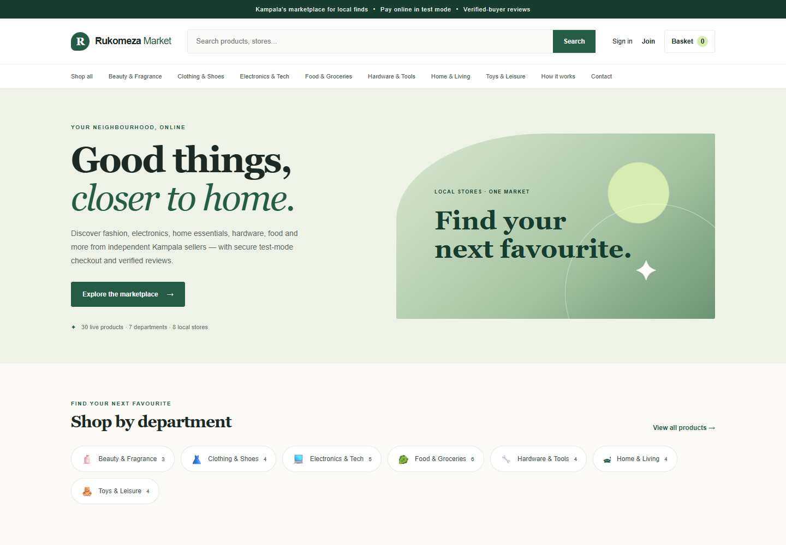

*The catalogue includes keyword/category/price filters, sorting, stock badges and
verified ratings.*

**Product detail and verified reviews**

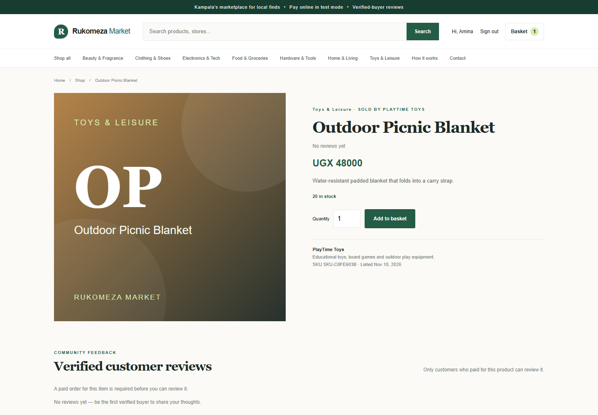

**Cart and checkout**

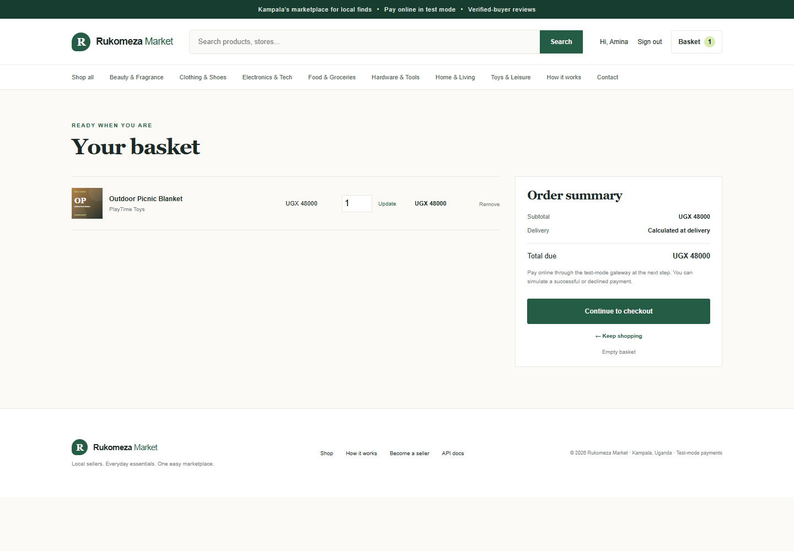

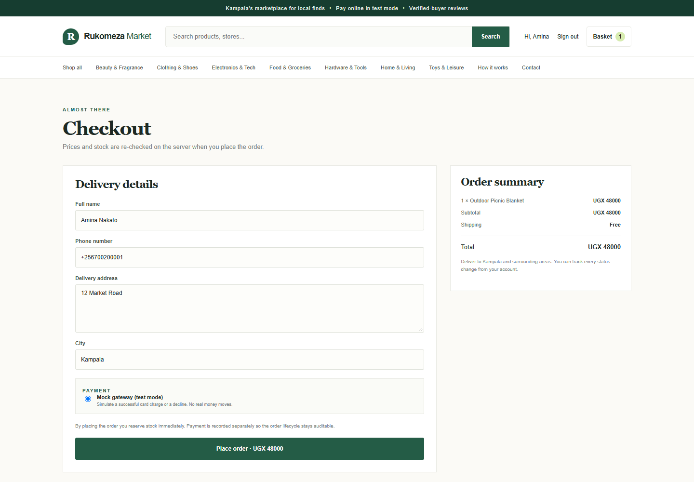

**Mock payment**

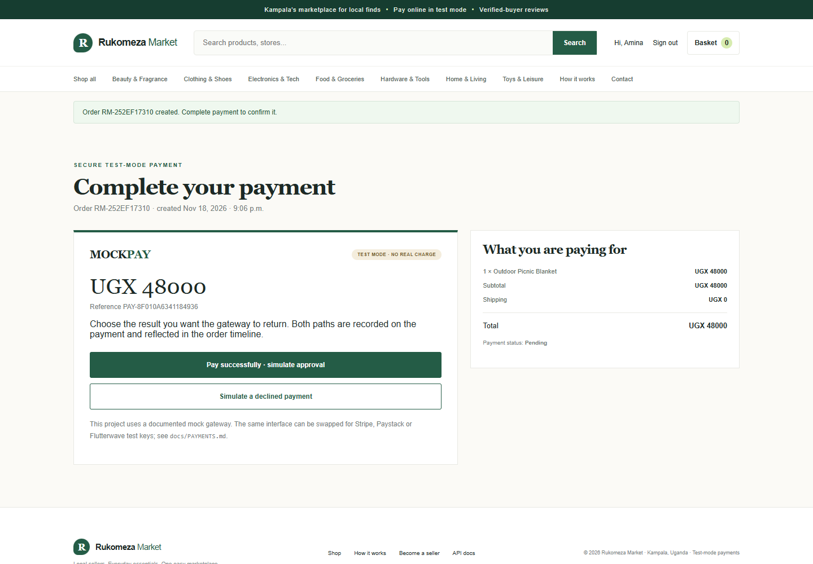

**Order tracking**

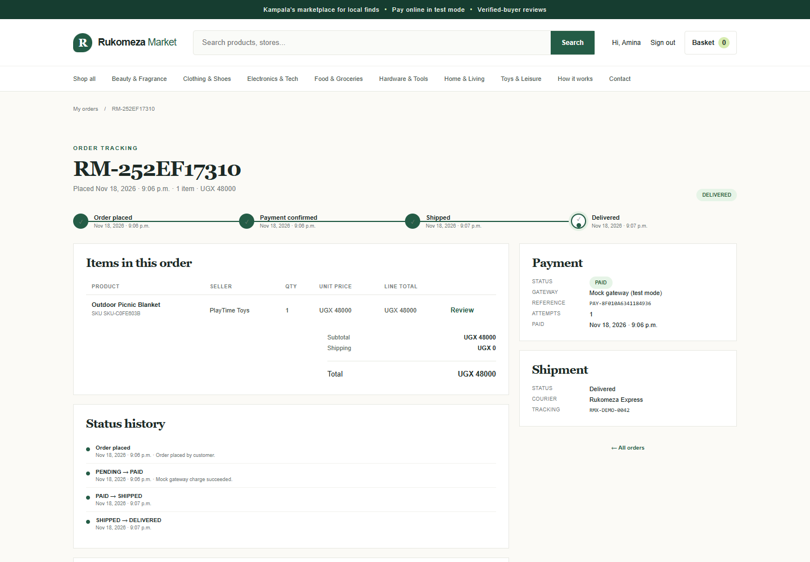

**Seller studio**

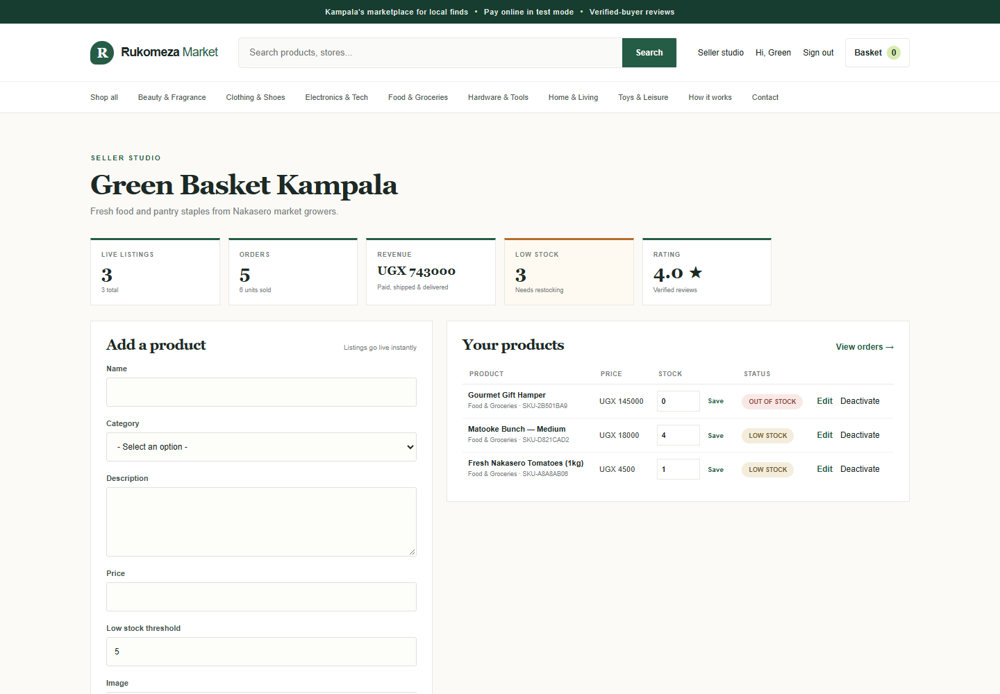

**Admin dashboard and reports**

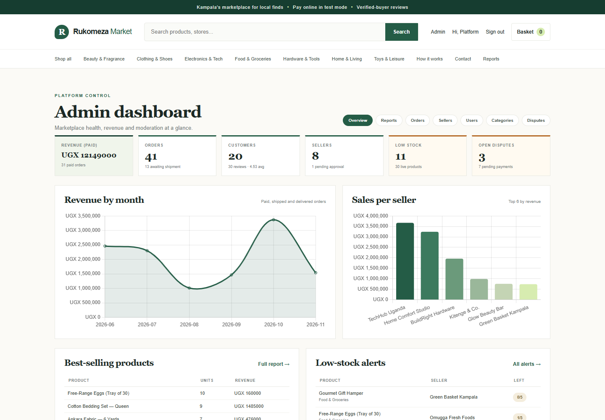

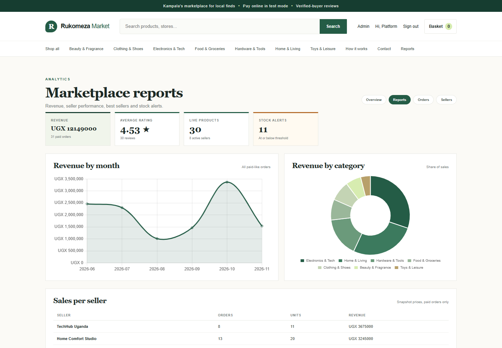

**API documentation**

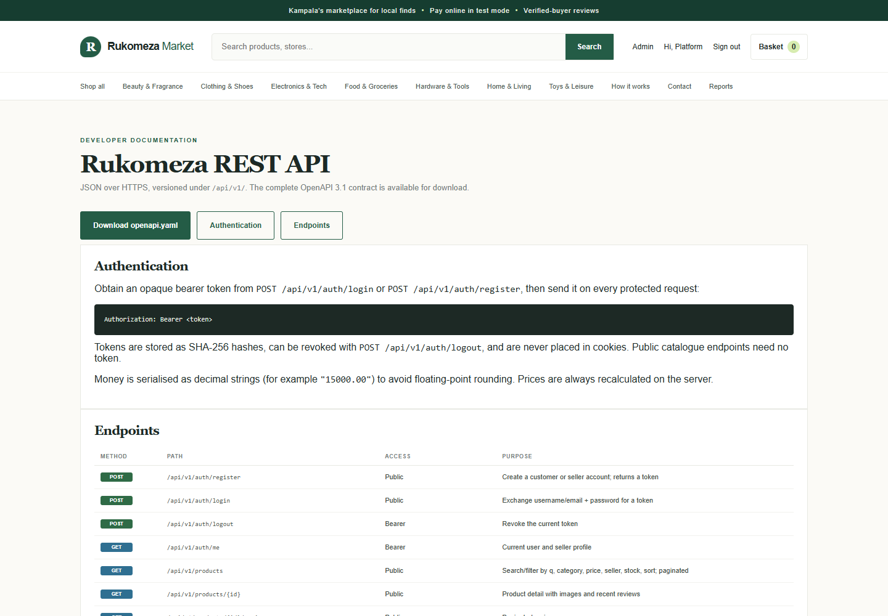

**Mobile layout**


### 9.2 Usability decisions

* Persistent cart across pages; guest cart merges on login.
* Inline validation messages and flash messages for every action.
* Status badges and a four-step timeline make order state obvious.
* Admin tables expose only allowed actions for the current state.
* Charts use a local copy of Chart.js, so reports work without a CDN.
* Empty states explain the next action instead of showing a blank table.

---

## 10. Testing

The suite is `store/tests.py`; run:

```bash
FAST_TESTS=1 python manage.py test store
```

Result:

```
Ran 58 tests in 3.794s
OK
```

Coverage by area:

| Area | Representative tests |
|---|---|
| Schema constraints | negative stock, zero price, invalid status, rating 6, duplicate primary image |
| Snapshots | price change does not alter historical order; derived line total |
| Auth/RBAC | registration hashing, email login, blocked login, customer cannot open seller/admin, seller cannot open admin |
| Catalogue | keyword/category/price filters, unapproved seller hidden, inactive product hidden |
| Cart | stock ceiling, 99-unit line limit, update/remove, guest-to-user merge |
| Checkout | order + snapshot + decrement, stale quantity creates nothing, current price used, cancel restores stock |
| Payments | success, failure + retry, idempotency, cannot pay cancelled order, payment page |
| Reviews | non-buyer refused, verified buyer accepted, duplicate refused |
| Seller | publish with inventory, unapproved cannot publish, cannot edit others, stock update, deactivate, scoped orders |
| Admin | approve seller, dispatch/deliver, illegal transition blocked, reports correct, dispute resolution |
| API | token requirement, register/login, filters, cart → order → pay → tracking, quantity conflict, seller ownership, verified reviews, admin-only reports, webhook signature, JSON 404 |
| Concurrency | 10 threads, 5 units: exactly 5 sales, stock 0 |
| Seed | minimum counts for every required entity |

Manual smoke tests covered every page as anonymous, customer, seller and admin.

---

## 11. Deployment

### 11.1 Platform and configuration

| Item | Value |
|---|---|
| Host | Render web service (Python, free tier) |
| Database | Render PostgreSQL / Neon PostgreSQL |
| Start command | `gunicorn marketplace_project.wsgi:application --bind 0.0.0.0:$PORT --workers 2 --timeout 120` |
| Build command | `bash build.sh` (install, collectstatic, migrate, idempotent seed) |
| Health check | `/healthz` → JSON with database status |
| Static files | WhiteNoise + `CompressedStaticFilesStorage` |
| HTTPS | Automatic Render certificate; HSTS + secure cookies + SSL redirect |
| Secrets | Render environment variables only |

Environment variables (full table in `docs/DEPLOYMENT.md`):
`DJANGO_SECRET_KEY`, `DJANGO_DEBUG=False`, `DJANGO_ALLOWED_HOSTS`,
`DJANGO_CSRF_TRUSTED_ORIGINS`, `DATABASE_URL`, `MOCK_GATEWAY_SECRET`,
`SEED_DEMO`.

### 11.2 Live evidence

> **Status:** the application screenshots in §9 are included in
> `docs/screenshots/`. The hosting-dashboard screenshots below must be captured
> after deploying with the account that owns the Render/Neon resources; the
> repository already contains `render.yaml`, `build.sh`, `Procfile` and
> `Dockerfile`, and `docs/DEPLOYMENT.md` gives the exact steps.

| Evidence to capture | Target file |
|---|---|
| Live storefront over HTTPS | `screenshots/20-live-home.png` |
| Render web service dashboard (Live + URL) | `screenshots/21-render-service.png` |
| Render deploy log (migrate/seed) | `screenshots/22-render-deploy-log.png` |
| Render environment variables (values hidden) | `screenshots/23-render-env.png` |
| Render PostgreSQL dashboard | `screenshots/24-render-database.png` |
| Health check JSON | `screenshots/25-healthz.png` |
| GitHub repository (no `.env`) | `screenshots/26-github-repo.png` |

### 11.3 Reproducing the deployment

1. Push the repository to GitHub (already published at
   <https://github.com/joelleruk-lab/smart-ecommerce-marketplace>).
2. In Render: **New → Blueprint**, select the repository; `render.yaml` creates
   the web service and PostgreSQL. The one-click URL is
   <https://render.com/deploy?repo=https://github.com/joelleruk-lab/smart-ecommerce-marketplace>.
3. Add `DATABASE_URL` if you use Neon instead of Render Postgres.
4. Deploy and open `/healthz`.
5. Log in with the demo accounts and run the verification checklist in
   `docs/DEPLOYMENT.md` §6.

The deployment files are production-oriented: `DEBUG=False`, secret-key
environment variable, PostgreSQL SSL, HSTS, two Gunicorn workers and a health
check. No secret is committed.

---

## 12. Rubric mapping

| Criterion | Marks | Evidence |
|---|---|---|
| ERD and 3NF schema | 10 | `docs/erd.png`, `docs/ERD.md` §1–2 |
| Integrity constraints and price snapshot | 10 | `store/models.py`, `docs/ERD.md` §3–4, tests |
| Seed data (5+ categories, 8 sellers, 30 products, 20 customers, 40 orders, 60 items, 30 reviews) | 5 | `seed_demo` command; 7/9/30/20/40/81/30 produced |
| Indexed search/filter + report queries | 5 | `docs/ERD.md` §4–5, `services/catalogue.py`, `services/reports.py` |
| REST/GraphQL endpoints | 5 | `store/api.py`, `store/api_urls.py`, OpenAPI, Postman |
| Payment gateway / documented mock | 5 | `docs/PAYMENTS.md`, `services/payments.py`, tests |
| Validation, error handling, verified reviews | 5 | forms, API validation, review tests |
| Transaction + row locking, no overselling | 10 | `services/checkout.py`, `ConcurrencyTests` |
| Secure registration/login, hashed passwords | 5 | Django auth, PBKDF2, sessions/tokens |
| Role-based access control | 5 | `permissions.py`, `api_auth.py`, ownership tests |
| Responsive UI with all views | 6 | screenshots, templates |
| Admin charts + order tracking | 4 | Chart.js dashboard/reports, timeline |
| Live deployment over HTTPS | 10 | Render config + screenshots (add after deploy) |
| Online database + working features | 6 | `/healthz`, live screenshots |
| Secrets in platform env vars | 2 | `.env.example`, Render env screenshot |
| Hosting dashboard screenshots | 3 | `docs/screenshots/21–26` |
| Report: ERD, normalisation, decisions | 6 | This report §4, §7 |
| Report: screenshots of app/deployment | 4 | §9, §11 |
| Swagger/OpenAPI or Postman | 2 | `docs/openapi.yaml`, `docs/postman_collection.json` |

---

## 13. Limitations and future work

* **Mock payment** — no real card data or money movement; documented integration
  points for Stripe/Paystack/Flutterwave test keys.
* **Single shipment per order** — a multi-seller order is dispatched as one
  fulfilment. Splitting into per-seller shipments would be the next step.
* **Search** — portable `icontains`; a PostgreSQL trigram/GIN index or a search
  service would improve scale.
* **Media** — local disk or CDN URLs; Cloudinary/R2 upload can be enabled with
  environment credentials.
* **Notifications** — console email backend; SMTP and order emails are future
  work.
* **Rate limiting** — login throttling and API quotas would be added with a
  shared cache (e.g. Redis) in production.
* **Refunds** — recorded in the mock payment state; real refunds need gateway
  API calls.

---

## 14. Conclusion

The project delivers the full marketplace lifecycle rather than a catalogue
mock-up. The schema is normalised to 3NF with explicit integrity constraints;
checkout is transactionally safe under concurrency; historical prices are
immutable; payments and order state are auditable; and the three roles see
exactly the functionality they need. The same rules are enforced in the HTML
interface and the JSON API, and 58 automated tests verify the critical paths.

Deployment artifacts are complete and production-oriented. The final step is to
publish the repository, create the Render/Neon resources with your accounts, and
replace the URL and hosting screenshots in §11 — the application code, database
migrations, seed data and monitoring endpoint are ready for that deployment.

---

## 15. Appendices

### A. Demo accounts

| Role | Login | Password |
|---|---|---|
| Admin | `admin` / `admin@rukomeza.test` | `Admin#2026` |
| Customer | `amina@example.com` | `Customer#2026` |
| Seller | `greenbasket@example.com` | `Seller#2026` |
| Pending seller | `kikuubo@example.com` | `Seller#2026` |

### B. Local setup

```bash
python -m venv venv
venv\Scripts\activate
pip install -r requirements.txt
python manage.py migrate
python manage.py seed_demo
python manage.py runserver
```

### C. Test command

```bash
FAST_TESTS=1 python manage.py test store
```

### D. API quick reference

Full contract: `docs/openapi.yaml`. Human-readable: `/api/docs/`.

### E. Repository structure

```
marketplace_project/   settings, URLs, WSGI
store/                 models, services, API, views, forms, templates, tests
web/                   CSS, JS, images, seed art, Chart.js
docs/                  ERD, report, OpenAPI, Postman, deployment, payments, screenshots
scripts/               ERD/architecture/Postman generators, smoke tests
render.yaml            Render blueprint
build.sh               production build pipeline
Dockerfile             container image
```
